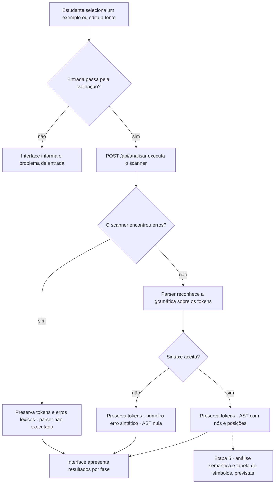

# Fluxograma da análise de código

1. O estudante escolhe um exemplo ou edita o código e aciona a análise. O frontend valida a entrada e a API a valida novamente antes do processamento.
2. O scanner identifica tokens e registra erros léxicos. Em caso de erro léxico, a resposta mantém os tokens reconhecidos e informa que a análise sintática ficou suspensa.
3. Sem erro léxico, o parser recebe a lista de tokens e verifica a gramática. Com sintaxe aceita, a API retorna a AST. Se houver erro de sintaxe, retorna o primeiro diagnóstico com sua posição.
4. A interface mantém os resultados léxicos visíveis e apresenta, separadamente, a AST, a suspensão da fase ou o diagnóstico sintático.
5. Na Etapa 5, a AST servirá de entrada para a análise semântica e a tabela de símbolos. Esse caminho aparece tracejado no fluxograma.
