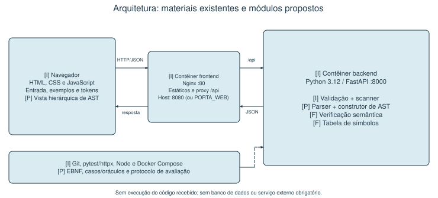
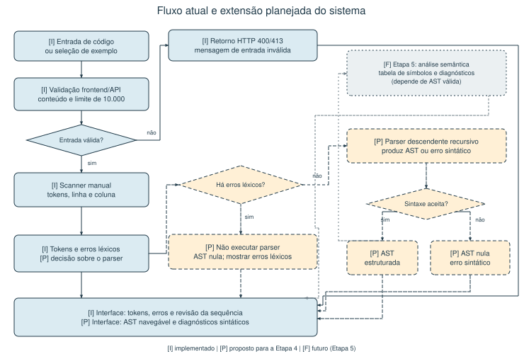

# Tarefa 4 - Materiais e Métodos

Tarefa 4 - Materiais e Métodos

**Proposta, fluxograma e plano de avaliação**
Thomaz da Silva Meira | Disciplina: Compiladores | 18 de novembro de 2026

### Ambiente web para o ensino do front-end de um subconjunto de Python

Este trabalho dá continuidade às três etapas anteriores e apresenta a versão inicial da seção Materiais e Métodos, acompanhada da atualização dos trabalhos relacionados e dos instrumentos de avaliação. A proposta será examinada com critérios e casos definidos antes da interpretação dos resultados. Não se apresentam resultados de aprendizagem de uma implementação ainda futura.

### Estado verificado e continuidade

O repositório foi consultado em 18/11/2026. A revisão-base **5d9d81a** contém validação de entrada, exemplos, scanner, API e interface com tokens e erros léxicos. **Parser, geração de AST e sua visualização ainda não estão implementados nessa revisão.** A análise semântica e a tabela de símbolos serão desenvolvidas na Etapa 5. O fluxograma e o contrato proposto distinguem esses estados, em lugar de tratar o roteiro de etapas como prova de funcionalidades já existentes.

Mantém-se o problema delimitado: apoiar graduandos iniciantes em Compiladores, com programação básica, na compreensão das relações entre código-fonte, tokens, estrutura sintática e informações semânticas. A linguagem de entrada continua sendo um subconjunto de Python. Seu uso permite explorar atribuições, expressões e indentação em programas curtos; não se presume domínio prévio de Python nem se promete cobrir toda a linguagem.

| Produto desta etapa | Situação |
| --- | --- |
| Pesquisa e matriz | Sete estudos preservados; dois novos: ParVis e YARPGen. |
| Proposta metodológica | Gramática, arquitetura, contrato, critérios, oráculos e formulário definidos. |
| Implementação disponível | Scanner e fluxo léxico da Etapa 3 preservados. |
| Próximas implementações | Parser/AST: Etapa 4 prática; semântica/símbolos: Etapa 5. |

## 1. Pesquisa complementar e trabalhos relacionados

A busca dirigida combinou termos sobre visualização de parsers e validação de compiladores, seguida de conferência de títulos, autores, ano e DOI em fontes primárias. Foram lidos os textos integrais de Costagliola et al. (2022) e Livinskii, Babokin e Regehr (2020). O primeiro foi obtido na Springer; o segundo, no servidor institucional de um autor. Ambos são diferentes dos sete trabalhos anteriores. A consulta ocorreu em 18/11/2026 e não constitui revisão sistemática ou levantamento exaustivo.

A seleção combina necessidades distintas do método. ParVis fornece referências para observar o uso e a correspondência entre representações. YARPGen trata de testes de compiladores, tema expressamente pertinente à validação dos analisadores; não será apresentado como ferramenta educacional nem aplicado diretamente a programas Python. Documentação da linguagem e código do projeto complementam os artigos, sem substituí-los como fundamentação científica.

### 1.1. Costagliola et al. (2022) - ParVis

**Referência.** COSTAGLIOLA, Gennaro; DE ROSA, Mattia; FUCCELLA, Vittorio; MINAS, Mark. Visual exploration of visual parser execution. Multimedia Tools and Applications, v. 81, p. 299-317, 2022. DOI: [10.1007/s11042-021-10624-6](https://doi.org/10.1007/s11042-021-10624-6). Publicação on-line em 2021; adota-se o ano do fascículo, 2022.

O problema é compreender dados interdependentes durante a análise sintática. ParVis reproduz rastros de parsers instrumentados e coordena fonte, tokens, pilha e árvores de derivação. O usuário controla reprodução, retorno e granularidade. A árvore de eventos organiza a visualização; não comprova uma AST do programa.

A avaliação comparou ParVis à depuração convencional de CUP, em desenho intrassujeitos contrabalançado com 14 mestrandos. Houve maior acerto nas tarefas assistidas, 64,3% contra 42,9%, menor tempo e satisfação medida por SUS. Esses achados não são ganho de aprendizagem nem retenção. A amostra experiente, a instância específica e a dificuldade de gerenciar várias janelas limitam a transferência.

Para este projeto, o estudo fundamenta tarefas de acerto/tempo, destaque coordenado e painéis integrados. Sua adaptação ao parser Python exigirá implementação e avaliação próprias. Móvel e acessibilidade assistiva permanecem NI. Localizadores: §§2-5, p. 300-314.

### 1.2. Livinskii et al. (2020) - YARPGen

**Referência.** LIVINSKII, Vsevolod; BABOKIN, Dmitry; REGEHR, John. Random Testing for C and C++ Compilers with YARPGen. Proceedings of the ACM on Programming Languages, v. 4, n. OOPSLA, artigo 196, p. 196:1-196:25, 2020. DOI: [10.1145/3428264](https://doi.org/10.1145/3428264).

O estudo enfrenta falhas persistentes de compiladores e vieses de geradores de testes. YARPGen combina políticas de geração de programas C/C++, prevenção de comportamento indefinido e teste diferencial, com reprodução e redução de falhas. A campanha relatou 221 defeitos em GCC, LLVM e Intel C++ Compiler. Experimentos adicionais examinaram políticas, custo e cobertura; os benefícios dependeram da configuração.

A versão avaliada concentra-se em otimizações escalares, sem abranger toda a linguagem. Não há avaliação educacional. Para o projeto, contribui definir o domínio do oráculo, diversificar entradas e distinguir falha do serviço de uma AST incorreta. A comparação estrutural de ASTs será uma adaptação própria, sem executar o código do aluno. Aprovação ou ausência de divergência não prova correção. Localizadores: §§2-4, p. 196:2-196:20.

## 2. Quadro comparativo atualizado - processamento

✓ = confirmado; ✗ = ausência documentada; NI = informação não identificada; N/A = não aplicável à unidade de análise. Preservam-se os 14 critérios do enunciado e a coluna adicional de árvore de derivação, já adotada na Etapa 3.

| Trabalho / ferramenta | Web | Entrada de código | Exemplos | Léxica | Sintática | AST exibida | Árvore de derivação | Análise semântica | Tabela de símbolos | Código gerado exibido |
| --- | --- | --- | --- | --- | --- | --- | --- | --- | --- | --- |
| G - Graciano Junior et al. (2022); Ferramenta interativa | ✓ | ✓ | NI | ✓ | ✓ | NI | ✓ | ✗ | NI | ✗ |
| B - Borela et al. (2025); Ferramenta educacional | ✓ | ✓ | ✓ | ✓ | ✓ | NI | ✓ | NI | ✓ | ✓ |
| R - Stamenković e Jovanović (2019); Revisão de simuladores | N/A | N/A | N/A | N/A | N/A | N/A | N/A | N/A | N/A | N/A |
| S - Abounegm et al. (2024); STELLA | ✓ | ✓ | ✓ | ✓ | ✓ | NI | NI | ✓ | NI | NI |
| H - Herber e Weninger (2025); Visualizador de bytecode | ✓ | NI | ✓ | NI | NI | NI | NI | NI | NI | ✓ |
| I - Del Vado Vírseda (2023); ITT | NI | ✓ | ✓ | ✓ | ✓ | NI | ✓ | NI | NI | NI |
| V - Koitz-Hristov et al. (2025); VisOpt | ✓ | ✓ | ✓ | ✓ | ✓ | NI | NI | ✓ | ✓ | ✓ |
| P - Costagliola et al. (2022); ParVis | NI | NI | NI | ✓ | ✓ | NI | ✓ | NI | NI | NI |
| Y - Livinskii et al. (2020); YARPGen / método de validação | N/A | N/A | N/A | N/A | N/A | N/A | N/A | N/A | N/A | N/A |

**Unidades diferentes.** R é uma revisão; Y é um método de validação de compiladores industriais. Seus N/A não significam ferramentas sem funcionalidades. Em S e V há análises internas, sem confirmação de visualização didática do front-end. P apresenta tokens e análise produzidos externamente por um parser instrumentado.

**Ausência e precisão.** Nesta atualização, Web do ITT passa de ✗ para NI: a descrição de aplicações locais confirma a plataforma relatada, mas não comprova ausência de toda instância em navegador. As fontes anteriores foram preservadas; a correção aplica a mesma regra de evidência usada nas novas linhas.

## 2. Quadro comparativo atualizado - apoio educacional

| Trabalho / ferramenta | Passo a passo | Diagnósticos | Explicações didáticas | Avaliação com estudantes | Resultados de aprendizagem |
| --- | --- | --- | --- | --- | --- |
| G - Graciano Junior et al. (2022); Ferramenta interativa | ✓ | ✓ | ✓ | ✓ | ✗ |
| B - Borela et al. (2025); Ferramenta educacional | ✗ | NI | ✓ | ✓ | ✗ |
| R - Stamenković e Jovanović (2019); Revisão de simuladores | N/A | N/A | N/A | N/A | N/A |
| S - Abounegm et al. (2024); STELLA | NI | ✓ | ✓ | ✓ | ✓ |
| H - Herber e Weninger (2025); Visualizador de bytecode | ✓ | ✓ | NI | NI | ✗ |
| I - Del Vado Vírseda (2023); ITT | ✓ | ✓ | ✓ | ✓ | ✓ |
| V - Koitz-Hristov et al. (2025); VisOpt | ✓ | ✓ | ✓ | ✓ | ✓ |
| P - Costagliola et al. (2022); ParVis | ✓ | ✓ | NI | ✓ | NI |
| Y - Livinskii et al. (2020); YARPGen / método de validação | N/A | N/A | N/A | N/A | N/A |

**Definição da última coluna.** ✓ registra medidas de conhecimento/desempenho formativo ou pré/pós-teste, sem afirmar causalidade ou ganho significativo. O desempenho assistido em tarefas de depuração de P é descrito separadamente como eficácia de uso, sem ser convertido em aquisição/retenção. S avalia atividades do curso; I utiliza notas e indicador composto; V mede pré/pós-teste, sem vantagem global significativa; H declara avaliação sistemática futura.

Os significados dos ✓ também variam: diagnósticos podem ser eventos técnicos ou mensagens acessíveis; explicações podem ser teoria integrada, documentação ou guia da linguagem. Pilha de parsing não equivale a tabela de símbolos, e árvore de derivação não confirma uma AST reduzida.

## 2.1. Caracterização e limites

| Trabalho | Tipo / plataforma | Linguagem / unidade | Recursos / foco | Avaliação | Contribuição / limites |
| --- | --- | --- | --- | --- | --- |
| G - Graciano Junior et al. (2022); Ferramenta interativa | Ferramenta didática; web responsiva; Angular/Python. | Pseudolinguagem baseada em Portugol. | Tokens, autômato animado e árvore de derivação; teoria e passos reversíveis. | 5 ex-alunos em avaliação preliminar; resultados do formulário não publicados. | Referência para teoria integrada; semântica e IR planejados. |
| B - Borela et al. (2025); Ferramenta educacional | Compilador didático; web; Java, ANTLR 4 e LLVM. | Linguagem própria inspirada em C. | Tokens, árvore de derivação, símbolos, IR/Assembly e execução; comparação de otimizações. | 27 respondentes, dos quais 74,1% alunos; questionário de percepção, média geral 4,81/5. | Coordena código e representações; não apresenta algoritmo passo a passo. |
| R - Stamenković e Jovanović (2019); Revisão de simuladores | Revisão; JFLAP/jFAST desktop, Seshat web e Automata Simulator Android. | Não há linguagem de programas única. Java/Python são implementações das ferramentas. | Autômatos, tabelas e árvores; funcionalidades variam entre os quatro sistemas. | Relatos secundários de avaliações: jFAST 18, Seshat 56 e JFLAP cerca de 70 participantes. | Oferece critérios de comparação; não é uma ferramenta nem experimento próprios. |
| S - Abounegm et al. (2024); STELLA | Curso, documentação, playground web e projetos-base locais. | STELLA, funcional e estaticamente tipada. | Verificadores de tipos com extensões incrementais; lexer/parser fornecidos. | 49 alunos ativos em 2 turmas; desempenho em atividades, sem grupo de controle. | Orienta progressão de conceitos; pré-requisitos e regras de tipos diferem do Python introdutório. |
| H - Herber e Weninger (2025); Visualizador de bytecode | Visualizador web baseado em rastros produzidos externamente. | MicroJava e seu bytecode. | Código/bytecode lado a lado, memória e navegação reversível. | Feedback piloto sem perfil/n informados; avaliação sistemática futura. | Inspira controle da navegação; interpretação não integra o escopo inicial do projeto. |

## 2.1. Caracterização e limites (continuação)

| Trabalho | Tipo / plataforma | Linguagem / unidade | Recursos / foco | Avaliação | Contribuição / limites |
| --- | --- | --- | --- | --- | --- |
| I - Del Vado Vírseda (2023); ITT | Tutor interativo; aplicações locais Java (.jar), integrado a Flex/Bison. | Expressões aritméticas e progressão até PL/0; implementações em C/C++/Java. | Relaciona estados, regras, árvore de derivação, atributos e trechos da implementação. | Comparações entre grupos em três anos; medidas de notas e indicador composto de sucesso/motivação. | Referência para ligações teoria-código; requer ferramentas locais e não demonstra o recorte Python. |
| V - Koitz-Hristov et al. (2025); VisOpt | Visualizador web; compilador integrado e cliente interativo. | Jova (semelhante a Java), com destino Jasmin. | Otimizações locais em fonte, grafo de fluxo, IR e alvo; passos reversíveis e explicações. | Quase-experimento online com 53 mestrandos: 26 experimentais e 27 de comparação. | Orienta interação e avaliação; foco no back-end e sem melhora global significativa demonstrada. |
| P - Costagliola et al. (2022); ParVis | Visualizador Java de rastros; instâncias CUP/LALR e GPSR. | Entrada textual ou visual do parser instrumentado; sem recorte Python pronto. | Fonte, tokens, pilha, estados e árvores de derivação coordenados. | 14 mestrandos; condições contrabalançadas; desempenho, tempo e SUS. | Informa interação e método; múltiplas janelas geraram dificuldades. |
| Y - Livinskii et al. (2020); YARPGen / método de validação | Gerador e arcabouço de teste diferencial; finalidade técnica. | Subconjunto de C/C++; compiladores GCC, LLVM e Intel. | Políticas de geração, prevenção de entradas indefinidas, comparação e redução. | Campanha de dois anos e experimentos técnicos; sem avaliação educacional. | Orienta diversidade e reprodução; seus recursos internos não são vistas didáticas. |

## 2.2. Rastreabilidade das classificações

Os localizadores das fontes anteriores foram preservados e conferidos na Etapa 3. A consulta complementar acrescenta P e Y. Borela usa paginação interna 1-11, equivalente às páginas 171-181 dos anais; Herber usa páginas 1-12 do manuscrito dos autores. Todas as marcações ✓/✗ abaixo remetem ao artigo da respectiva linha.

### G - Graciano Junior et al. (2022)

**Web, entrada.** §4, p. 227; §5.1, p. 228.

**Exemplos NI.** §7.1, p. 233: manual com programas prontos ainda seria elaborado. Isso não comprova ausência de quaisquer exemplos experimentáveis nos materiais; a disponibilidade desse recurso permanece não confirmada.

**Léxica e sintática.** §§5.1-5.2, p. 228-232; Figuras 3-12.

**Árvore de derivação; AST NI.** §5.2, p. 231-232: há terminais e não terminais; não é identificada uma AST distinta.

**Semântica e código ✗.** §7.1, p. 233: módulos futuros.

**Passos, diagnósticos, explicações.** §5.1, p. 228-229; §5.2, p. 231-232: próximo/anterior e destaque do erro.

**Estudantes; aprendizagem ✗.** §4, p. 227; §7.1, p. 233: cinco respostas; resultados não incluídos no artigo.

### B - Borela et al. (2025)

**Web, entrada, exemplos.** §3.1, p. 4; §3.2.3, p. 7: editor e seleção de exemplos.

**Léxica, sintática, derivação.** §3.2.2, p. 6; §3.2.3, p. 7. AST NI: o texto especifica árvore de derivação.

**Semântica NI.** §3.2.1, p. 5: tipagem/conversões implícitas descritas, sem detalhar verificações de nomes e tipos. NI não significa ausência de tratamento semântico.

**Símbolos, código.** §3.2.2, p. 6; §3.2.3, p. 7-8: funções/escopos, LLVM IR e Assembly.

**Passos ✗; explicações.** §2, p. 3, exclui passo a passo; §3.2.3, p. 7, descreve guia da linguagem. Diagnósticos NI: validar entrada não comprova mensagens didáticas.

**Estudantes; aprendizagem ✗.** §4, p. 8-9: questionário de aceitação e percepção; não é teste de conhecimento.

### R - Stamenković e Jovanović (2019)

**N/A em toda a linha.** §§5.1-5.4, p. 11-17, comparam quatro softwares. A unidade desta linha é uma revisão, por isso não se agregam funcionalidades nem amostras.

**Plataformas e escopo.** Tabelas 1-2, p. 17-18; versões examinadas em 2019, sem atualização automática para versões atuais.

**Móvel e avaliação.** §5.3, p. 14-16, descreve adaptação do Seshat e estudo de terceiros; §5.4, p. 16-17, aplicativo Android.

### S - Abounegm et al. (2024)

**Web, entrada, exemplos, explicações.** §2.3, p. 10; §§2.1-2.2, p. 4-9: documentação, editor e programas de exemplo. Não se exige biblioteca embutida na interface.

**Léxica e sintática.** §3.1, p. 10-11: componentes fornecidos/gerados para os projetos. Sua execução interna não confirma visualização de tokens/AST.

**Semântica e diagnósticos.** §2, p. 3; §4, p. 12-13: verificadores de tipos; §2.3, p. 10: saída de erros.

**Estudantes e aprendizagem.** §§4.3-4.4, p. 14-16: atividades e recursos implementados; aprendizagem descritiva do curso, sem efeito isolado do playground.

**Demais NI.** AST/derivação exibidas, tabela visual, IR exibida e navegação por passos não são confirmadas. Implementar compilador é opção, não prova de IR no playground.

### H - Herber e Weninger (2025)

**Web, exemplos.** §III, p. 2-3; §VIII, p. 8-9 do manuscrito dos autores. Entrada direta/editável de código na interface: NI; carrega rastros.

**Código exibido.** §V, p. 4-5: mostra bytecode gerado externamente; não significa compilação pela interface.

**Passos e diagnósticos.** §VII, p. 7-8; §III, passo 8, p. 3; §IV.C, p. 4: navegação e erros do interpretador.

**Símbolos NI.** §IV.B, p. 4: metadados em regiões de memória não confirmam tabela estática de símbolos exibida.

**Estudantes NI; aprendizagem ✗.** §X, p. 10: avaliação sistemática ainda não realizada. Feedback piloto não identifica estudantes nem apresenta medidas de aprendizagem.

### I - Del Vado Vírseda (2023)

**Web NI; entrada e exemplos.** §§3-4, p. 335-337: descrevem aplicações .jar e expressões. A plataforma local está confirmada, mas não se transforma a falta de menção a navegador em ausência comprovada. Correção conservadora da Etapa 3.

**Léxica e sintática.** §3, p. 335-336: scanner/parser gerados por Flex/Bison; §4, p. 337: inspeção interativa da análise.

**Derivação ✓; AST NI.** §4, p. 337, Figuras 3-4: construção com símbolos e produções; não identifica AST reduzida.

**Semântica NI; símbolos NI.** §§3-4 mostram avaliação de atributos de expressões. Isso não confirma verificações de nomes/tipos ou uma tabela de símbolos.

**Código gerado NI.** Código destacado é a implementação do analisador. Gerar scanner/parser não comprova exibição de código-alvo do programa analisado.

**Passos, diagnósticos, explicações.** §4, p. 337-338: estados, reduções, conflitos e trechos responsáveis; sessões guiadas.

**Estudantes e aprendizagem.** §§5-6, p. 338-339: grupos e notas; sucesso combina aprovação e motivação, não mede isoladamente domínio conceitual.

### V - Koitz-Hristov et al. (2025)

**Web, entrada, exemplos.** §3, p. 604; §3.2, p. 605: editor e programa inicial.

**Léxica, sintática, semântica.** §3.1, p. 604; §3.2, p. 605: análises internas e retorno de erros. Não se confirma ensino visual do front-end.

**AST e derivação NI.** §3.3, p. 605: grafo de fluxo não é uma árvore sintática.

**Símbolos, código, passos, explicações.** §§3.3-3.4, p. 605-606: tabela explicitamente nomeada, valores nas otimizações, IR/Jasmin, avanço/retorno, reprodução e texto explicativo.

**Diagnósticos.** §3.2, p. 605: mensagem e posição do erro.

**Estudantes, aprendizagem.** §§4.1-4.2, p. 607-608: pré/pós-teste. ✓ registra medição, não benefício; diferença global dos ganhos não significativa.

### P - Costagliola et al. (2022)

**Unidade e plataforma.** §2, p. 300-303: recebe rastros e usa API Java/leitor JavaScript. Web, editor e biblioteca de exemplos: NI. Formulário web do experimento não torna o visualizador web.

**Léxica e sintática.** §3.1, p. 304-306: tokens com posições e execução LALR instrumentada. Componentes do parser são externos à visualização.

**Derivação; AST NI.** §3.1, p. 305-306: árvore parcial dos elementos da pilha. A árvore de eventos de §2 não é AST.

**Passos e diagnósticos.** §§2.1-2.2, p. 302-304; §3.1, p. 305: reprodução, retorno, saltos e eventos de erro sintático.

**Estudantes; aprendizagem NI.** §§4-5, p. 310-314: avaliação de tarefas assistidas e SUS. Aquisição/retenção de conhecimento não foi isolada.

**Demais NI.** Não se confirmam verificações de nomes/tipos, tabela de símbolos do programa, código-alvo ou teoria integrada. Pilha gramatical não é tabela de símbolos.

### Y - Livinskii et al. (2020)

**N/A: unidade metodológica.** §§2-4, p. 196:2-196:20: valida compiladores industriais; não é ambiente de entrada/análise de programas de estudantes. N/A evita comparar recursos internos com vistas educacionais.

**Pertinência e limites.** §2 distingue falha interna e resultado errado; §3.3 trata diversidade; §3.4, reprodução; §4.5, limites da cobertura. Aplicações ao parser Python são adaptações desta proposta.

## 2.3. Análise comparativa e contribuição pretendida

O conjunto anterior cobre finalidades diferentes: Graciano Junior et al. (2022) apresentam as análises iniciais; Borela et al. (2025), artefatos de uma cadeia mais ampla; a revisão de 2019, simuladores distintos; STELLA, implementação de sistemas de tipos; ITT, relações entre implementação e teoria; VisOpt, otimizações; e Herber e Weninger, interpretação de bytecode. A diversidade impede concluir que uma solução é superior apenas por acumular recursos. Também impede tratar a revisão ou o método YARPGen como um único compilador educacional.

ParVis reforça a utilidade de coordenar representações e fornece uma limitação concreta de IHC: os participantes relataram dificuldade com muitas janelas. A resposta proposta é organizar o ambiente em painéis/abas, manter o trecho de origem selecionado e permitir expandir a subárvore relevante. Isso é uma decisão a testar, e não evidência de redução de carga cognitiva já obtida no projeto. A visualização hierárquica deverá diferenciar navegar na AST pronta de animar sua construção; somente o primeiro recurso está previsto na implementação inicial.

YARPGen acrescenta um cuidado metodológico que não se resolve por interface: uma resposta HTTP normal pode conter estrutura incorreta. Por isso, não basta verificar que existe uma árvore. Os casos terão hierarquias esperadas, entradas dentro de um domínio explícito e registros reproduzíveis. Os princípios de diversidade e comparação independente informam o método; as regras de C/C++ e os números históricos de defeitos não serão transferidos para Python.

Usabilidade, desempenho assistido e aprendizagem também permanecem separados. Opiniões de aceitação em Borela não são teste de conhecimento; atividades de STELLA não isolam o playground; os resultados de VisOpt não demonstram ganho global significativo; ParVis mede uso assistido. A avaliação prevista investigará primeiro correção e realização de tarefas, deixando um eventual experimento de aprendizagem para protocolo adicional.

### Dispositivos e acesso

Não se afirma que acesso móvel seja inédito: Graciano Junior et al. já descrevem responsividade, e a revisão de 2019 inclui aplicativo Android. Para ParVis, móvel e recursos assistivos são NI. O projeto adotará rótulos, foco visível, navegação por teclado, mensagens que não dependam apenas de cor e uma versão textual da AST. No celular, propõem-se abas, seleção por toque e preservação de contexto. Um viewport automatizado não comprova usabilidade móvel nem acessibilidade; tarefas em dispositivos reais deverão ser registradas separadamente.

### Diferencial delimitado e revisão da introdução

A contribuição pretendida é organizar, para graduandos iniciantes, a relação entre texto, tokens e AST de um subconjunto de Python, com explicações em português, diagnósticos separados por fase e referências de origem. As ferramentas existentes já atendem partes dessa necessidade. O diferencial é uma hipótese contextualizada de organização didática, sujeita a verificação, sem alegação de exclusividade, superioridade ou inexistência de soluções equivalentes. O escopo da introdução permanece o mesmo; apenas se torna mais precisa a relação entre recurso visual, estado de implementação e natureza da evidência.

## 3. Materiais e Métodos - versão inicial para o artigo

### 3.1. Linguagem e escopo do software

O estudo consiste na concepção e no desenvolvimento incremental de um ambiente educacional web para o ensino do front-end de compiladores. O público-alvo são estudantes de graduação em Computação ou Inteligência Artificial com conhecimentos básicos de programação, que estejam iniciando ou cursando Compiladores. O ambiente será um recurso complementar às atividades da disciplina, com exemplos e explicações do recorte utilizado.

A linguagem analisada é um subconjunto de Python 3.12, escolhido por permitir relacionar atribuições e expressões curtas à estrutura de blocos por indentação. A referência da linguagem descreve `NEWLINE`, `INDENT` e `DEDENT`, oferecendo base explícita para ligar forma textual e agrupamento de comandos (Python Software Foundation, s.d.-a). A escolha não se apoia somente em popularidade nem pressupõe que todos os estudantes já dominem Python.

| Elemento | Recorte implementado ou proposto |
| --- | --- |
| Identificadores e números | ASCII [A-Za-z_][A-Za-z0-9_]*; inteiros decimais sem zeros iniciais, exceto 0; reais como 2.5, .5 e 5.; sinal é operador separado. |
| Operadores / delimitadores | + - * / = == != < > <= >=; parênteses e dois-pontos. |
| Comentários e espaço | Comentário # de linha ignorado; espaços separam lexemas; tabulação inicial é recusada no recorte; há tokens de indentação e linha. |
| Construções sintáticas previstas | Atribuição simples, operadores unários, precedência aritmética, comparação única, if/else e blocos aninhados. |
| Não suportado | Strings, expoentes, Unicode em nomes, listas, funções, classes, laços, elif, importações, lógica and/or/not, comparação encadeada e comandos isolados de expressão. |

A gramática proposta é apresentada a seguir. Ela não equivale à gramática de Python completo. Em particular, uma construção válida na linguagem completa pode ser recusada por estar fora do recorte. `if` não introduz novo escopo de nomes, reatribuição não é redeclaração ilegal e verificações futuras de vinculação não serão tratadas como um sistema geral de tipos estáticos (Python Software Foundation, s.d.-b).

```ebnf
programa      = { comando }, EOF ;
comando       = atribuicao, NEWLINE | condicional ;
atribuicao    = IDENTIFICADOR, "=", expressao ;
condicional   = "if", expressao, ":", NEWLINE, INDENT, bloco, DEDENT,
                [ "else", ":", NEWLINE, INDENT, bloco, DEDENT ] ;
bloco         = comando, { comando } ;
expressao     = soma, [ comparador, soma ] ;
comparador    = "==" | "!=" | "<" | "<=" | ">" | ">=" ;
soma          = produto, { ("+" | "-"), produto } ;
produto       = unaria, { ("*" | "/"), unaria } ;
unaria        = ("+" | "-"), unaria | primaria ;
primaria      = IDENTIFICADOR | LITERAL_INTEIRO | LITERAL_REAL
                | "(", expressao, ")" ;

```

As repetições de soma/produto produzem associação à esquerda; sinais unários são associados ao operando; a precedência de multiplicação/divisão supera adição/subtração. As cláusulas seguem o alinhamento da indentação, conforme o recorte da especificação de `if` (Python Software Foundation, s.d.-c; s.d.-d). O marcador EOF será interno ao adaptador do parser. Comentários sem comandos poderão produzir uma AST de programa vazio; entrada vazia ou só de espaços continuará recusada pela validação já existente.

### 3.2. Materiais e tecnologias

A base disponível utiliza HTML, CSS e JavaScript sem framework no cliente, Nginx para arquivos estáticos e proxy, Python 3.12 com FastAPI/Uvicorn no backend e Docker Compose para coordenar os serviços. O scanner é manual e utiliza a biblioteca padrão. Essa organização permite preservar o contrato HTTP e testar separadamente validação, análise e apresentação, sem acrescentar uma biblioteca somente para exibir uma árvore pequena.

| Material | Versão / situação e justificativa |
| --- | --- |
| Backend | Python 3.12; FastAPI 0.115.0; Uvicorn 0.30.6. Mantêm a API e o ambiente da etapa anterior. |
| Frontend / AST | HTML/CSS/JavaScript existentes; árvore hierárquica expansível em DOM proposta, com conteúdo inserido como texto e versão textual equivalente. Não se declara uso atual de D3, Lark ou ANTLR no projeto. |
| Parser | Descendente recursivo manual proposto, com níveis da EBNF e construtor de AST em JSON; facilita vincular funções às construções reduzidas do recorte. Não foi comparado experimentalmente a LL/LR. |
| Testes | pytest 8.3.3 e httpx 0.27.2 no backend; executor Node nativo no frontend; Playwright opcional para o fluxo de navegador já existente. |
| Execução / versão | Dockerfiles Python 3.12-slim e Nginx 1.27-alpine; Git/GitHub. Os campos novos e a documentação são desenvolvidos sobre uma revisão identificada. |

Os materiais de entrada compreendem os exemplos existentes de atribuição, aritmética, condicional e erros intencionais, mais os 40 casos definidos para o plano. Os casos são elaboração deste projeto, derivados do escopo e dos critérios, sem copiar entradas de C/C++ do YARPGen. O tutorial diferencia categoria de token e lexema, explica a indentação e alerta que aceitação léxica não comprova sintaxe correta. O apoio à AST será acrescido somente quando implementado.

O desenvolvimento e a verificação desta entrega ocorrem em macOS. Foram consultados Docker CLI 29.9.1 e Compose 5.6.0; a execução por contêiner usa a porta pública 8080 ou a variável `PORTA_WEB`, e backend 8000 apenas na rede interna. O acesso previsto inclui Chrome e Firefox atuais; cada coleta registrará a versão usada. A publicação pública não é necessária ao método. Downloads das imagens e dependências são requisitos de preparação, não serviços externos chamados para analisar o programa do aluno.

```sh
docker compose config --quiet
PORTA_WEB=8083 docker compose up --build -d
# abrir http://localhost:8083
bash scripts/testar.sh
BASE_URL=http://localhost:8083 bash scripts/smoke_test.sh
docker compose down
```

### 3.3. Arquitetura e contrato de comunicação

A Figura 1 organiza os módulos e suas responsabilidades. O navegador edita e envia texto; Nginx serve o cliente e encaminha `/api`; a API valida a entrada e chama o scanner. A extensão prevista acrescentará um adaptador de tokens, parser e construtor de AST, mantendo o analisador independente da visualização. ParVis fornece precedente de separação entre dados de processamento e apresentação, mas a proposta utilizará uma AST em JSON, sem reproduzir toda a arquitetura de rastros do artigo (Costagliola et al., 2022).



Figura 1 - Arquitetura atual e módulos propostos. I: implementado; P: previsto na Etapa 4; F: Etapa 5. Fonte: elaboração para o projeto, a partir da revisão 5d9d81a.

O contrato atual é `POST /api/analisar`, com JSON contendo `codigo`. São preservados `recebido`, `mensagem`, `resumo`, `sucesso`, `tokens` e `erros`. HTTP 400 identifica entrada inválida; 413, limite excedido; 200 indica processamento léxico concluído, inclusive com erros. Para não quebrar consumidores anteriores, `sucesso` continuará indicando somente sucesso léxico. O frontend futuro deverá ler um estado sintático próprio, sem convertê-lo implicitamente em aprovação global.

| Campo novo proposto | Definição |
| --- | --- |
| estado_sintatico | nao_executado, valido ou invalido. Erro léxico impede execução do parser. |
| ast | Objeto apenas quando a sintaxe é aceita; null se não executada ou recusada. |
| erros_sintaticos | Lista separada; primeiro diagnóstico com esperado, encontrado, linha, coluna e mensagem. A lista de erros léxicos permanece independente. |
| Nós da AST | Programa, Atribuicao, Nome, Numero, Binaria, Unaria, Comparacao e Se; filhos conforme os oráculos, identificador e origem no texto. |

A AST deverá representar construções do programa, não cada terminal e não terminal da derivação. Parênteses alteram o agrupamento, mas não se tornam nós de pontuação. Os esqueletos de referência verificam estrutura; posições e correspondência com tokens terão verificações próprias. A interface deverá permitir expansão seletiva e seleção do trecho de origem. Não se promete animação passo a passo da construção da árvore na primeira versão: o controle já existente apenas revisa os tokens prontos.

### 3.4. Fluxo de funcionamento

A Figura 2 explicita as saídas de erro e a decisão proposta sobre a continuação entre fases. Uma entrada inválida retorna orientação antes da análise. O scanner acumula erros quando possível e mantém os tokens reconhecidos. No fluxo proposto, qualquer erro léxico bloqueia o parser para evitar que uma estrutura incompleta produza diagnósticos sintáticos em cascata. Tokens e mensagens léxicas continuam visíveis.



Figura 2 - Fluxograma com caminhos de entrada inválida, erro léxico e erro sintático. Linhas e rótulos separam o fluxo existente da extensão planejada; semântica e símbolos são futuros. Fonte: elaboração para o projeto.

Com tokens válidos, o parser percorrerá a sequência conforme a EBNF e construirá os nós. No primeiro erro sintático, interromperá a construção, retornará AST nula e indicará o elemento esperado e encontrado. A opção inicial não inclui recuperação sintática, nem apresentará árvore parcial como programa válido. Uma AST aceita poderá alimentar a análise semântica somente na etapa seguinte; esse módulo não é executado nem simulado nesta entrega.

O limite atual de 10.000 caracteres será preservado. Propõe-se ainda 64 níveis de aninhamento para conter o processamento; esse limite será descrito como restrição do ambiente, não da linguagem completa. O texto recebido não será executado por `eval`/`exec`. Não haverá dependência de banco de dados ou compilação remota do programa do estudante.

### 3.5. Critérios, casos e oráculos de teste

Os critérios e o conjunto de casos foram definidos no protocolo v1.0 antes da nova execução de testes e registrados por hash SHA-256. Os resultados esperados não foram extraídos da própria saída do futuro parser. O método combina exemplos curados de referência, entradas inválidas por fase e bordas. Essa distinção dialoga com o cuidado de YARPGen em definir o domínio das comparações e reproduzir falhas, sem importar suas regras de geração de C/C++ (Livinskii et al., 2020).

Há 40 casos: 22 destinados à sintaxe, 12 ao léxico, 2 à validação de entrada e 4 à semântica futura. A divisão por fase-alvo não implica que todo caso já seja executável. Os casos sintáticos incluem atribuições, precedência, parênteses, sinais, comparação, `if/else`, blocos aninhados e construções incompletas. Os oráculos diferenciam, por exemplo, `x = 2 + 3 * 4`, cuja raiz da expressão é soma, de `x = (2 + 3) * 4`, cuja raiz é multiplicação.

Na futura implementação, uma comparação independente poderá normalizar a AST de `ast.parse` do CPython 3.12 apenas no subconjunto comum, sem executar código. Essa é adaptação metodológica de teste diferencial, não ferramenta implementada nem procedimento já demonstrado por YARPGen em Python. Casos deliberadamente fora do recorte exigem diagnóstico esperado, e não igualdade de aceitação com Python completo. Falhas do serviço, AST incorreta e problema do oráculo serão registrados separadamente.

| ID | Critério | Forma de verificação | Fundamento / adaptação |
| --- | --- | --- | --- |
| C1 | Correção léxica | Tipo, lexema e posições coincidem com o oráculo. | Escopo próprio; feedback localizado em Graciano et al. (2022). |
| C2 | Correção sintática | Aceitação/recusa conforme EBNF; não executar com erro léxico. | Especificação própria do recorte. |
| C3 | Correção da AST | Hierarquia e operadores iguais à referência; posição verificada separadamente. | Domínio/oráculo: adaptação de Livinskii et al. (2020), §2. |
| C4-C5 | Diagnósticos e clareza | Fase, esperado/encontrado, localização e orientação; explicação pelo avaliador. | Graciano et al. (2022), §§5.1-5.2; adaptação à sintaxe. |
| C6 | Legibilidade / navegação | Conclusão, tempo, ajuda e erros para localizar raiz/ramo/nó. | Costagliola et al. (2022), §§4-5; tarefas próprias. |
| C7 | Consistência | Fonte, token e nó selecionado apontam o mesmo elemento. | Borela et al. (2025), §3.2.3; adaptação à AST. |
| C8 | Execução do plano | Aprovados/executados e executados/planejados por fase; skips fora do numerador. | Definição operacional deste projeto. |
| C9 | Robustez / limites | Entrada vazia/extensa e profundidade são tratadas sem falha interna. | Especificação e limites próprios. |
| C10-C11 | Reprodução / documentação | Iniciar revisão e executar exemplo/tutorial; registrar passos e ambiente. | Procedimento próprio; reprodução em Livinskii et al. (2020), §3.4. |
| C12 | Semântica futura | Nome sem vínculo, reatribuição e análise conservadora, sem afirmar tipagem estática geral. | Referência Python §4.2; etapa futura. |

A meta técnica de liberação será ausência de falhas conhecidas nos casos aplicáveis à fase implementada; trata-se de decisão de engenharia, não limiar retirado dos artigos nem eficácia pedagógica. Qualquer mudança de caso, critério ou gramática será versionada com motivo e impacto, preservando os registros da primeira execução. Cobertura de linhas, se medida, será complementar e não prova de correção (Livinskii et al., 2020, §4.5).

### 3.6. Método de avaliação

A avaliação será organizada em procedimentos complementares. Primeiro, testes automatizados de scanner, parser, endpoint, interface e regressão verificarão requisitos funcionais. O módulo inicial dos testes lê o arquivo canônico do plano e executa apenas as fases disponíveis; parser e semântica recebem marcação explícita de pendência. Depois da implementação, essas pendências serão substituídas por comparações reais com os oráculos e pelos estados da API.

Segundo, testes manuais documentados percorrerão a entrada de código, a solicitação de análise e a leitura de tokens, AST ou erros. Para cada caso, serão registrados entrada, esperado, observado, status, defeito, correção e revisão. A execução reproduzível deverá obter uma cópia identificada, iniciar Compose, conferir saúde dos serviços, exemplos e testes, registrando sistema, versões e portas. Uma execução bem-sucedida não será generalizada para todos os sistemas operacionais.

Terceiro, será conduzida avaliação por pares após a implementação das tarefas correspondentes. Pretende-se recrutar de 6 a 10 estudantes, por conveniência, de cursos de Computação ou Inteligência Artificial que cursem ou tenham cursado Compiladores; esse número é meta de recrutamento, não amostra observada ou cálculo de poder estatístico. Professores poderão revisar o conteúdo qualitativamente, com perfil descrito separadamente.

Após consentimento e orientação padronizada, cada participante realizará tarefas de aproximadamente 20-30 minutos, incluindo interpretar precedência, localizar um ramo, identificar causa de erro e relacionar um nó ao texto. Serão anotados conclusão sem/com ajuda, tempo e dificuldades. A utilização de tarefas observáveis e medidas separadas inspira-se em Costagliola et al. (2022), mas o desenho não reproduz seu experimento contrabalançado nem transfere seus resultados. Dispositivo e contexto serão registrados por categoria, sem generalizar computador para celular.

Em seguida, será aplicado o formulário próprio apresentado no Apêndice B, com escala de concordância de 1 a 5 e opção N/A. Ele aborda inserção, clareza, token/lexema, mensagens, AST, indentação, correspondência entre vistas, apoio em português, limites e uso por teclado/toque. Não será denominado SUS nem convertido para sua pontuação. Serão descritos número de respostas por item, distribuição e comentários; N/A não será substituído pela resposta neutra. Não haverá coleta de nome, matrícula, e-mail ou telefone, nem associação dos códigos de participante à identidade pessoal.

A percepção de contribuição à compreensão será relatada como opinião. Ganho cognitivo exigiria instrumento próprio e protocolo adicional com questões equivalentes antes/depois e, quando pertinente, comparação planejada. VisOpt exemplifica por que competência percebida e desempenho medido devem ser separados (Koitz-Hristov et al., 2025). Os resultados técnicos já disponíveis não serão interpretados como evidência de aprendizagem da AST.

### 3.7. Limitações do método

A versão-base não contém parser/AST; por isso, seus casos não podem ser apresentados como aprovados. A semântica, a tabela de símbolos e avaliações com pessoas também permanecem futuras. O estudo se limita ao subconjunto documentado, não avalia Python completo, execução do programa, otimização ou geração de código. Não serão adaptados casos de declaração sem inicialização, ponto e vírgula obrigatório ou laços como se fossem requisitos deste projeto.

A amostra por conveniência e a participação do desenvolvedor no acompanhamento limitam a generalização e podem influenciar respostas. Uma interface responsiva ou um teste automatizado não certificam acessibilidade nem substituem avaliação com pessoas. Sem experimento de aprendizagem e controles próprios, não serão afirmados ganho cognitivo, superioridade sobre ferramentas relacionadas ou efeito causal da organização visual.

## Apêndice A - Casos previamente definidos

Todos os casos são elaboração para o projeto. O inventário abaixo resume as entradas; os programas completos, as posições previstas, as expectativas por fase e os esqueletos de AST constam em `docs/etapa4/casos-de-teste.json` e na versão legível. O arquivo de definição mantém os resultados observados nulos; execuções ficam em registro separado.

| Caso | Fase-alvo | Entrada / descrição | Resultado esperado |
| --- | --- | --- | --- |
| CT-01 | sintatica | x = 1 | AST de referência; sintaxe aceita |
| CT-02 | sintatica | x = 2 + 3 * 4 | AST de referência; sintaxe aceita |
| CT-03 | sintatica | x = (2 + 3) * 4 | AST de referência; sintaxe aceita |
| CT-04 | sintatica | x = -2 * 3 | AST de referência; sintaxe aceita |
| CT-05 | sintatica | x = 2 < 3 | AST de referência; sintaxe aceita |
| CT-06 | sintatica | if x > 0:\n    y = 1\n | AST de referência; sintaxe aceita |
| CT-07 | sintatica | if x > 0:\n    y = 1\nelse:\n    y = 2\n | AST de referência; sintaxe aceita |
| CT-08 | sintatica | if x > 0:\n    if y < 2:\n        z = 1\n    else:\n        z = 2\nelse:\n    z = 3\n | AST de referência; sintaxe aceita |
| CT-09 | sintatica | x = 2\ny = x + 3\nif y >= 5:\n    y = y / 2\n | AST de referência; sintaxe aceita |
| CT-10 | sintatica | a = .5\nb = 5.\nc = 00.5 | AST de referência; sintaxe aceita |
| CT-11 | sintatica | y = x + 1 | AST de referência; sintaxe aceita |
| CT-12 | sintatica | x = (1 +\n    2)\n | AST de referência; sintaxe aceita |

## Apêndice A - Casos (continuação)

| Caso | Fase-alvo | Entrada / descrição | Resultado esperado |
| --- | --- | --- | --- |
| CT-13 | lexica | if else ifx _x1 | Tokens e posições corretos |
| CT-14 | lexica | a<=b != c == d >= e | Tokens e posições corretos |
| CT-15 | lexica | a = 0\nb = .5\nc = 5.\nd = 00.5 | Tokens e posições corretos |
| CT-16 | lexica | # início\nx = 10 # anotação\ny=2 | Tokens e posições corretos |
| CT-17 | lexica | x = @ 2\ny = 3 | Erro léxico localizado e recuperação |
| CT-18 | lexica | x = 123abc | Erro léxico localizado e recuperação |
| CT-19 | lexica | x = 1.2.3 | Erro léxico localizado e recuperação |
| CT-20 | lexica | x = "texto | Erro léxico localizado e recuperação |
| CT-21 | lexica | x = @ 2\ny = $ 3 | Erro léxico localizado e recuperação |
| CT-22 | lexica | if x:\n\ty=1 | Erro léxico localizado e recuperação |
| CT-23 | lexica | if x:\n    y=1\n  z=2 | Erro léxico localizado e recuperação |

## Apêndice A - Casos (continuação)

| Caso | Fase-alvo | Entrada / descrição | Resultado esperado |
| --- | --- | --- | --- |
| CT-24 | sintatica | if x > 0\n    y = 1\n | AST nula; diagnóstico sintático/limite |
| CT-25 | sintatica | x = (2 + 3 | AST nula; diagnóstico sintático/limite |
| CT-26 | sintatica | x = 2 + | AST nula; diagnóstico sintático/limite |
| CT-27 | sintatica | else:\n    x = 1\n | AST nula; diagnóstico sintático/limite |
| CT-28 | sintatica | x = = 2 | AST nula; diagnóstico sintático/limite |
| CT-29 | sintatica | if = 2 | AST nula; diagnóstico sintático/limite |
| CT-30 | sintatica | if x > 0:\n | AST nula; diagnóstico sintático/limite |
| CT-31 | sintatica | x = 1 < 2 < 3 | AST nula; diagnóstico sintático/limite |
| CT-32 | sintatica | x | AST nula; diagnóstico sintático/limite |

CT-31 e CT-32 são válidos em Python completo, porém ficam fora da gramática proposta; a mensagem deverá indicar o recorte. O parser não rejeitará nome não vinculado como erro de sintaxe (CT-11).

## Apêndice A - Casos (continuação)

| Caso | Fase-alvo | Entrada / descrição | Resultado esperado |
| --- | --- | --- | --- |
| CT-33 | semantica | y = x + 1 | Reservado à Etapa 5; não executar agora |
| CT-34 | semantica | cond = 1\nif cond > 0:\n    x = 2\ny = x | Reservado à Etapa 5; não executar agora |
| CT-35 | semantica | x = 1\nx = 2\ny = x | Reservado à Etapa 5; não executar agora |
| CT-36 | semantica | if 1:\n    x = 2\ny = x | Reservado à Etapa 5; não executar agora |
| CT-37 | entrada | (vazia) | HTTP 400; entrada_vazia |
| CT-38 | lexica | # apenas comentário | Tokens e posições corretos |
| CT-39 | entrada | 10.001 caracteres | HTTP 413; entrada_muito_grande |
| CT-40 | sintatica | x = ( ... 65 níveis ... 1 ... ) | AST nula; diagnóstico sintático/limite |

CT-34 investiga um aviso conservador sobre nome atribuído em apenas um ramo, sem anunciar erro inevitável. CT-35 não deverá tratar reatribuição como redeclaração ilegal; CT-36 não criará escopo novo por causa do if. CT-40 verifica limite do sistema, não invalidade de Python.

## Apêndice B - Instrumento de avaliação por pares

**Instrumento planejado; ainda não aplicado.** Escala: 1 discordo totalmente; 2 discordo; 3 nem concordo nem discordo; 4 concordo; 5 concordo totalmente; N/A não utilizei ou não pude avaliar. Trata-se de formulário próprio, não SUS. Itens indisponíveis não receberão notas artificiais.

A apresentação informará voluntariedade, possibilidade de interromper ou não responder e uso acadêmico agregado. A concordância será sim/não; se não, o formulário será encerrado. Serão solicitados apenas perfil geral, situação em Compiladores, experiência geral com Python e categoria de dispositivo/contexto, sem identificadores pessoais. Professores e estudantes serão descritos separadamente.

1. Entendi como inserir ou selecionar um programa e solicitar a análise.

2. Os nomes das fases e os controles da interface foram claros.

3. A tabela me permitiu distinguir a categoria de um token do seu lexema.

4. As posições de linha e coluna ajudaram a localizar o trecho do código.

5. As mensagens indicaram claramente a fase do problema e o que precisava ser revisto.

6. Consegui distinguir uma falha léxica de uma falha sintática.

7. A árvore apresentou hierarquia e rótulos legíveis. **N/A enquanto a AST não estiver implementada.**

8. Consegui expandir/recolher a árvore sem perder o trecho que estava examinando. **N/A quando indisponível.**

9. A relação entre fonte, tokens e nó selecionado tornou o processamento mais compreensível. **N/A quando indisponível.**

10. A apresentação de INDENT/DEDENT ajudou a relacionar a indentação de Python à estrutura dos blocos.

11. Os exemplos curtos em Python foram adequados ao meu conhecimento prévio.

12. As explicações em português foram suficientes para iniciar a exploração sem ajuda do desenvolvedor.

13. O controle de revisão dos tokens me permitiu avançar e retornar no meu ritmo.

14. Foi claro que sucesso léxico não significa que o programa esteja sintaticamente correto.

15. Foi claro quais recursos de Python não pertencem ao subconjunto do ambiente.

16. O material de apoio me ajudou a reproduzir um exemplo e interpretar o resultado.

17. No dispositivo utilizado, consegui acionar os controles e ler os resultados sem dificuldade.

18. Ao usar teclado ou toque, consegui concluir as ações previstas. **N/A se não utilizou essa forma de interação.**

19. As mensagens foram compreensíveis sem depender exclusivamente de cores.

20. A integração das representações foi útil para acompanhar as etapas do programa. **N/A para uma integração ainda indisponível.**

21. Percebi que a ferramenta contribuiu para minha compreensão de compiladores. **Percepção autorrelatada, não ganho medido.**

22. A representação das informações semânticas foi compreensível. **Não aplicar na Etapa 4; somente após implementação da Etapa 5.**

## Apêndice B - Questões abertas e observação

1. Qual mensagem ou representação ficou mais difícil de compreender? Indique o exemplo ou a tarefa.

2. Em que momento você perdeu o contexto ao navegar? O que ajudaria a recuperá-lo?

3. Encontrou problema técnico? Descreva entrada, ação e resultado, sem incluir dados pessoais.

4. Qual aspecto da relação entre código, tokens e AST ficou mais claro ou continuou confuso?

5. A indentação e os tokens INDENT/DEDENT foram úteis? O que deveria mudar na explicação?

6. Quais alterações você sugere para computador, celular ou uso por teclado?

7. Há alguma necessidade de acesso não atendida que deseja relatar voluntariamente? Não é necessário identificar condição pessoal ou diagnóstico.

| Tarefa | Atividade prevista | Registro do observador |
| --- | --- | --- |
| T1 | Inserir CT-02 e solicitar análise. | Conclusão, tempo, ajuda; distinção token/lexema. |
| T2 | Comparar CT-02 e CT-03 na AST. | Operadores e efeito dos parênteses; após implementação. |
| T3 | Localizar ramos de CT-07/CT-08. | Correspondência if/else e dificuldades de navegação. |
| T4 | Examinar CT-17 e CT-24. | Distingue fase e localiza causa do erro. |
| T5 | Relacionar nó ao trecho de origem. | Acerto e consistência; após implementação da seleção. |
| T6 | Repetir exploração curta em dispositivo móvel. | Toque/teclado, legibilidade e contexto; registrar dispositivo. |

Durante as tarefas, o observador registrará conclusão, ajuda, tempo aproximado e dificuldade. A ficha completa de tarefas e as regras de inclusão/registro constam no protocolo. Os itens sobre AST ou semântica somente serão apresentados quando o recurso existir. Os itens de indentação, coordenação, explicações e documentação examinam a contribuição pretendida, sem pressupor ineditismo.

## Apêndice C - Verificação técnica e atualização da base

Esta verificação se refere à integridade da entrega metodológica e às fases já existentes. Não equivale à avaliação futura do parser ou à coleta por pares. O protocolo v1.0 foi registrado por SHA-256 antes da execução; os oráculos não foram ajustados depois de observar os resultados.

| Verificação observada em 18/11/2026 | Resultado e alcance |
| --- | --- |
| Backend: python -m pytest -q | 119 aprovados, 26 ignorados explicitamente, nenhuma falha; 1 aviso de dependência. |
| Composição dos aprovados | 102 testes anteriores + 14 verificações da parte disponível dos casos + 3 verificações estruturais do plano. |
| Pendências | 22 casos de sintaxe e 4 de semântica não executados; expectativas futuras de CT-17/CT-38 também permanecem pendentes. |
| Frontend: node --test | 52 testes aprovados; fluxo léxico existente, sem supor visualização de AST. |
| Docker Compose | Configuração validada; servidor Docker desligado, sem nova execução dos contêineres nesta etapa. Histórico da Etapa 3 preservado separadamente. |

Dos 40 casos, 14 tiveram verificação da parte disponível, sendo 12 sem expectativa adicional futura e 2 com alcance parcial. Logo, não se declara aprovação integral de 40 casos nem taxa de sucesso do parser. O plano canônico permanece separado do registro de execução para preservar a definição anterior aos resultados.

O repositório recebeu documentação metodológica, EBNF, casos/oráculos, formulário, contrato proposto, fluxograma e arquitetura em formatos editável e gráfico, além da estrutura inicial de testes. A alteração no Compose monta `docs` somente para leitura no serviço de testes, permitindo consultar o mesmo arquivo de casos no ambiente local e no contêiner. Nenhum parser, regra semântica ou resultado de participantes foi fabricado para preencher o planejamento.

As fontes das Etapas 1-3 foram mantidas. A correção conservadora de Web no ITT foi registrada na matriz, e continuam as distinções entre AST e derivação, análise interna e visualização, opinião e desempenho. A introdução não exige alegar que a proposta seja a primeira ferramenta a reunir recursos já descritos na literatura.

## Referências

ABOUNEGM, Abdelrahman; KUDASOV, Nikolai; STEPANOV, Alexey. Teaching Type Systems Implementation with Stella, an Extensible Statically Typed Programming Language. In: CHANG, Stephen (ed.). TFPIE 2024. Electronic Proceedings in Theoretical Computer Science, v. 405, p. 1-19, 2024. DOI: [10.4204/EPTCS.405.1](https://doi.org/10.4204/EPTCS.405.1).

BORELA, Erik Pablo Schaefer; OLIVEIRA, Alessandra Lima de; CASTELLO BRANCO NETO, Wilson; SOUZA, Alexandre Perin de. Uma ferramenta educacional de apoio ao ensino de compiladores. In: WORKSHOP SOBRE EDUCAÇÃO EM COMPUTAÇÃO, 33., 2025, Maceió. Anais [...]. Porto Alegre: SBC, 2025. p. 171-181. DOI: [10.5753/wei.2025.7407](https://doi.org/10.5753/wei.2025.7407).

COSTAGLIOLA, Gennaro; DE ROSA, Mattia; FUCCELLA, Vittorio; MINAS, Mark. Visual exploration of visual parser execution. Multimedia Tools and Applications, v. 81, p. 299-317, 2022. DOI: [10.1007/s11042-021-10624-6](https://doi.org/10.1007/s11042-021-10624-6). Publicado on-line em 18 mar. 2021.

DEL VADO VÍRSEDA, Rafael. Visualizing Compiler Design Theory from Implementation Through an Interactive Tutoring Tool: Experiences and Results. In: CSEDU, 15., 2023, Prague. Proceedings [...], v. 2. SciTePress, 2023. p. 333-340. DOI: [10.5220/0011709800003470](https://doi.org/10.5220/0011709800003470).

GRACIANO JUNIOR, Wagner; GROSSERT, Iara Tavares da Silva; CASTELLO BRANCO NETO, Wilson; AVILA, Alex Junior. Ferramenta interativa para o ensino de compiladores. In: SIMPÓSIO BRASILEIRO DE EDUCAÇÃO EM COMPUTAÇÃO, 2., 2022, Online. Anais [...]. Porto Alegre: SBC, 2022. p. 224-233. DOI: [10.5753/educomp.2022.19217](https://doi.org/10.5753/educomp.2022.19217).

HERBER, Tobias; WENINGER, Markus. Trace-Based Bytecode Interpreter Visualization for Compiler Construction Education. In: IEEE WORKING CONFERENCE ON SOFTWARE VISUALIZATION, 13., 2025, Auckland. Proceedings [...]. IEEE, 2025. p. 13-24. DOI: [10.1109/VISSOFT67405.2025.00010](https://doi.org/10.1109/VISSOFT67405.2025.00010). Texto consultado: manuscrito dos autores.

KOITZ-HRISTOV, Roxane; MANDL, Franz; WOTAWA, Franz. VisOpt - Visualization of Compiler Optimizations for Computer Science Education. In: ACM TECHNICAL SYMPOSIUM ON COMPUTER SCIENCE EDUCATION, 56., 2025, Pittsburgh. Proceedings [...], v. 1. New York: ACM, 2025. p. 603-609. DOI: [10.1145/3641554.3701832](https://doi.org/10.1145/3641554.3701832).

LIVINSKII, Vsevolod; BABOKIN, Dmitry; REGEHR, John. Random Testing for C and C++ Compilers with YARPGen. Proceedings of the ACM on Programming Languages, v. 4, n. OOPSLA, artigo 196, p. 196:1-196:25, 2020. DOI: [10.1145/3428264](https://doi.org/10.1145/3428264).

MEIRA, Thomaz da Silva. Compiladores: software educacional de análise de código. Repositório de software. Revisão-base 5d9d81acfff427d07e4f2229a9a363948a737835, 2026. Disponível em: [revisão inspecionada](https://github.com/ThomazSMP/Compiladores/tree/5d9d81acfff427d07e4f2229a9a363948a737835). Acesso em: 18 nov. 2026.

PYTHON SOFTWARE FOUNDATION. The Python Language Reference, Python 3.12: Lexical analysis. [s.d.-a]. Disponível em: [referência léxica](https://docs.python.org/3.12/reference/lexical_analysis.html). Acesso em: 18 nov. 2026.

PYTHON SOFTWARE FOUNDATION. The Python Language Reference, Python 3.12: Execution model. [s.d.-b]. Disponível em: [modelo de execução](https://docs.python.org/3.12/reference/executionmodel.html). Acesso em: 18 nov. 2026.

PYTHON SOFTWARE FOUNDATION. The Python Language Reference, Python 3.12: Compound statements. [s.d.-c]. Disponível em: [comandos compostos](https://docs.python.org/3.12/reference/compound_stmts.html). Acesso em: 18 nov. 2026.

PYTHON SOFTWARE FOUNDATION. The Python Language Reference, Python 3.12: Expressions. [s.d.-d]. Disponível em: [expressões e precedência](https://docs.python.org/3.12/reference/expressions.html). Acesso em: 18 nov. 2026.

STAMENKOVIĆ, Srećko; JOVANOVIĆ, Nenad. Comparative analysis of simulation system for teaching compilers. BizInfo (Blace), v. 10, n. 2, p. 1-23, 2019. DOI: [10.5937/bizinfo1902001S](https://doi.org/10.5937/bizinfo1902001S).

### Identificação dos anexos novos

Após as referências seguem apenas os dois artigos acrescentados nesta etapa, sem repetir anexos anteriores. Anexo A: Costagliola et al. (2022), 19 páginas, original Springer sob CC BY 4.0. Anexo B: Livinskii et al. (2020), 25 páginas, cópia institucional dos autores com permissão expressa na primeira página para cópia pessoal ou em sala de aula, sem finalidade comercial, preservando aviso e citação. Esta versão combinada destina-se à entrega acadêmica; no repositório público ficam referências e links, não o PDF integral do Anexo B.

Fontes dos arquivos: [ParVis - Springer](https://link.springer.com/content/pdf/10.1007/s11042-021-10624-6.pdf) e [YARPGen - University of Utah](https://users.cs.utah.edu/~regehr/yarpgen-oopsla20.pdf). Consulta em 18/11/2026. Os artigos são mantidos integralmente, com seus avisos e referências.
